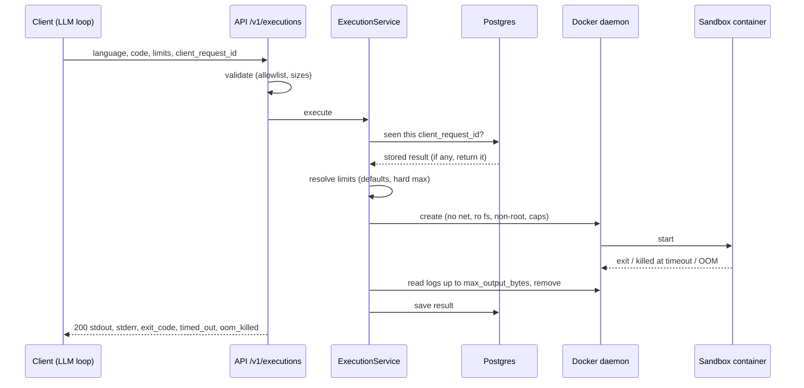

# SafeExec

[](https://github.com/jMautone/safeexec/actions/workflows/ci.yml)
[](LICENSE)


**A small, self-hosted HTTP API that runs LLM-generated code in a single-use,
locked-down container and hands the result back as data.**

<!-- To record the GIF: docker compose up --build -d && vhs docs/demo.tape -->

```text
=== attempt 1/3 ===
--- failed in 235 ms ---
KeyError: slice(1, None, None)
Fix it and return the complete program again.

=== attempt 2/3 ===
--- ok in 201 ms ---
mes 2: 150.0%
mes 3: 24.0%
mes 4: -6.5%
mes 5: 43.1%
```

*The [LLM correction loop](#example-the-llm-correction-loop): the model's code crashes
inside the sandbox, the traceback goes back to the model, the fixed version runs.*

## Why

When an agent writes code, someone has to run it, and running it on your machine or
inside your API process is the wrong place. Hosted sandboxes (E2B, Modal, Daytona)
solve this well but are a platform to adopt. SafeExec is the opposite end: one
endpoint, one `docker compose up`, under 1,000 lines of service code you can read in an afternoon, with
every hardening flag visible in [one file](src/safeexec/adapters/container_sandbox.py).

Each execution runs in a **single-use container**: non-root user, no network,
read-only root filesystem with a small bounded tmpfs, no swap, CPU and process caps,
all capabilities dropped and a wall-clock timeout. The container is destroyed after
every run, never reused. The executor lives behind a `Sandbox` interface so it can be
swapped for gVisor or a MicroVM without touching the domain.

> **Status: reference project.** v0.1.0 is complete and tested, including contract
> tests against real containers. It is not actively developed. Use it to learn from,
> fork, or run on a trusted host; see [Alternatives](#alternatives) for production.

## Quickstart (≤3 commands)

```bash
docker compose up --build -d
```

```bash
curl -s localhost:8000/healthz
```

```bash
curl -s -X POST localhost:8000/v1/executions \
  -H 'content-type: application/json' \
  -d '{"language": "python", "code": "print(\"hello sandbox\")"}'
```

Response:

```json
{
  "id": "…",
  "language": "python",
  "stdout": "hello sandbox\n",
  "stderr": "",
  "exit_code": 0,
  "duration_ms": 312,
  "timed_out": false,
  "oom_killed": false,
  "stdout_truncated": false,
  "stderr_truncated": false,
  "created_at": "…"
}
```

## Example: the LLM correction loop

[`examples/llm_loop.py`](examples/llm_loop.py) is the use case this service is built
for: Claude writes a program, SafeExec runs it in a single-use container, and any
failure comes back as *data* the model uses to fix its own code and try again.

```bash
docker compose up --build -d

# scripted author: same loop, no API key, shows a deliberate crash + fix
uv run --group examples python examples/llm_loop.py --offline

# real Claude, needs ANTHROPIC_API_KEY (or `ant auth login`)
uv run --group examples python examples/llm_loop.py "crecimiento mes a mes de estas ventas"
```

Two details worth copying into your own client: the `client_request_id` carries the
attempt number (reusing one would replay the stored result instead of running the
corrected code), and timeout/OOM are read off the 200 response rather than caught as
errors — that is what makes them usable as feedback.

## How it works



- **Failures are results.** Timeout, OOM and truncated output come back in a 200 so a
  model can read them ([ADR 0002](docs/decisions/0002-failures-are-results.md)).
- **Idempotent retries.** Same `client_request_id`, same stored result, no second run
  ([ADR 0003](docs/decisions/0003-postgres-for-idempotency.md)).
- **Swappable isolation.** The domain only knows the `Sandbox` protocol
  ([ADR 0001](docs/decisions/0001-ephemeral-containers-behind-sandbox-interface.md)).

## API

### `POST /v1/executions`

| Field | Type | Notes |
|---|---|---|
| `language` | `"python" \| "javascript"` | allowlist, anything else → 422 |
| `code` | string | required, ≤ 65 536 chars |
| `stdin` | string? | ≤ 16 384 chars |
| `limits` | object? | `timeout_ms`, `memory_mb`, `cpus`, `max_output_bytes` — validated against configured ranges; out-of-range → 422 with an actionable message |
| `client_request_id` | string? | idempotency key: retrying with the same id returns the stored result without re-executing |

Failure modes are modeled as results, not errors: `timed_out`, `oom_killed`, and
`*_truncated` come back in a 200 response.

Other statuses: `429` when execution capacity is exhausted (with `Retry-After`),
`503` when the container backend is unavailable.

### Observability

- `GET /healthz` — liveness.
- `GET /metrics` — Prometheus: `safeexec_executions_total{language,outcome}` and
  `safeexec_execution_duration_seconds{language}`.
- JSON logs to stdout with a per-request `request_id` (taken from or echoed to the
  `x-request-id` header).

## Development

```bash
uv sync
uv run pytest -m "not contract"   # domain + API tests, no Docker/DB needed
uv run pytest -m contract         # real executor tests, requires Docker daemon
uv run ruff check . && uv run ruff format --check . && uv run mypy
```

Domain tests use an injected `FakeSandbox` and in-memory repository — no containers
or database. Contract tests run real code in real containers and verify isolation
(network blocked, OOM kill, timeout kill, read-only fs, non-root, cleanup).

## Runbook

### Environment variables

All settings use the `SAFEEXEC_` prefix — see [.env.example](.env.example) for the
full list. Key ones:

| Variable | Default | Meaning |
|---|---|---|
| `SAFEEXEC_DATABASE_URL` | localhost Postgres | async SQLAlchemy URL |
| `SAFEEXEC_PYTHON_IMAGE` / `SAFEEXEC_NODE_IMAGE` | `python:3.13-slim` / `node:22-slim` | sandbox base images |
| `SAFEEXEC_SANDBOX_RUNTIME` | unset | set `runsc` to use gVisor as a hardened runtime |
| `SAFEEXEC_SANDBOX_WORKDIR_BASE` | system tmp | per-execution workdir base; must be daemon-visible under the same path when the API runs containerized |
| `SAFEEXEC_MAX_CONCURRENT_EXECUTIONS` | 4 | above this, requests get 429 |
| `SAFEEXEC_DEFAULT_*` / `SAFEEXEC_MAX_*` | see `.env.example` | limit policy defaults and hard caps |
| `SAFEEXEC_DOCKER_TIMEOUT_SECONDS` | 10 | timeout on every Docker daemon call |

### Host requirements for sandboxing

- A reachable Docker daemon. When the API itself runs in a container it needs
  `/var/run/docker.sock` mounted (sandboxes run as **sibling** containers) plus the
  workdir base bind-mounted host↔app at the same path (compose does both).
- Access to the daemon socket is root-equivalent: treat the API host as part of the
  sandbox trust boundary. For public exposure, evaluate gVisor (`runsc`) or a
  MicroVM-backed implementation of the `Sandbox` interface.
- Sandbox images are pulled on first use; pre-pull them to avoid first-request latency.

### Degradation behavior

- Docker daemon down → `503` with a generic actionable message (internals only in logs).
- Capacity saturated → `429` + `Retry-After`, service stays healthy.
- Every daemon call has an explicit timeout; a hung container is killed at the
  execution's wall-clock limit and always removed afterwards.

## Architecture

```
src/safeexec/
  api/        thin /v1 routers, middleware, error mapping — validate and delegate
  domain/     Sandbox contract, limits policy, idempotency, concurrency — no FastAPI, no Docker
  adapters/   ContainerSandbox (Docker SDK), Postgres repository, Prometheus metrics
  models.py   pydantic edge schemas + frozen domain entities
  config.py   pydantic-settings from env
```

Design decisions are in [`docs/decisions/`](docs/decisions/). The original planning
notes (in Spanish) are in [`docs/plan/`](docs/plan/).


## Alternatives

SafeExec is not the strongest sandbox out there. Pick something else when:

| Tool | Use it instead when |
| --- | --- |
| [E2B](https://e2b.dev) | You want Firecracker MicroVMs, SDKs, long-lived sessions and a hosted option (also self-hostable). |
| [microsandbox](https://github.com/superradcompany/microsandbox) | You want MicroVM isolation self-hosted on your own machine. |
| [Piston](https://github.com/engineer-man/piston) | You need dozens of languages behind a similar HTTP API. |
| [Judge0](https://judge0.com) | You are grading code against test cases (online judge). |
| [Daytona](https://daytona.io) / [Modal](https://modal.com) | You need full dev environments or GPU sandboxes as a service. |
| Claude's code execution tool | You only need code runs inside a Claude conversation and don't want to host anything. |

Pick SafeExec when you want a small, readable, self-hosted service whose isolation
settings and failure semantics you can audit and change in one place.

## Roadmap

Reference project: no new features are planned. Natural next steps for a fork:

- SQLite or in-memory repository for single-process setups (drop Postgres).
- A gVisor or Firecracker `Sandbox` implementation for untrusted public traffic.
- API keys and per-client rate limits.
- An MCP server wrapper so coding agents can call it as a tool.

## License

[MIT](LICENSE)
